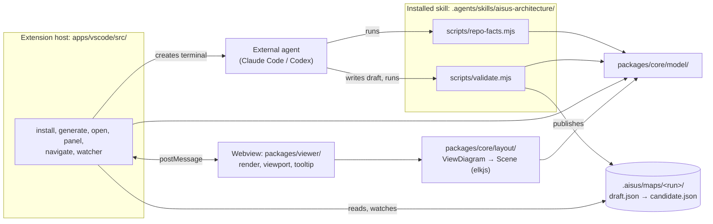
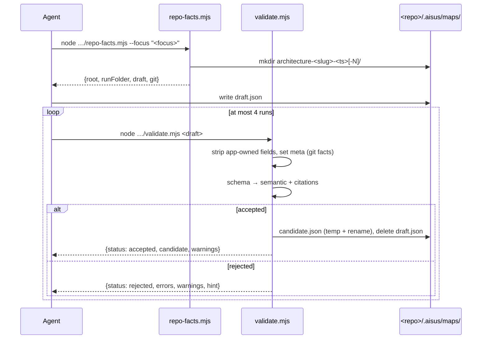
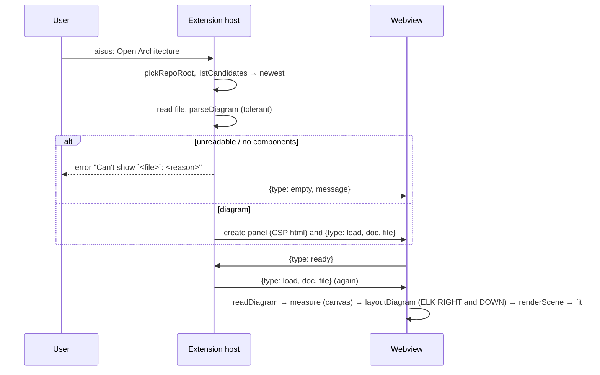

# aisus architecture

aisus is a VS Code extension that shows a repository's architecture as an Archify diagram and opens the code cited by each node. Diagrams are produced by an external coding agent (Claude Code or Codex) running the bundled `aisus-architecture` skill, whose scripts validate and publish the diagram; the extension itself never calls an LLM ([ADR 0002](adr/0002-external-coding-agent-generates-diagrams.md)).

Since v0.3 the same model modules also run in a core CLI (`dist/cli/aisus.mjs`, [ADR 0052](adr/0052-a-core-cli-shares-the-model-with-every-host.md)), in a GitHub Action that comments on pull requests ([ADR 0053](adr/0053-the-check-runs-as-a-javascript-action.md)), and in a one-file diagram page ([ADR 0051](adr/0051-the-diagram-page-is-one-offline-html-file.md)). The extension adds a sidebar where Generate, Refresh and Ask stream the agent's work ([ADR 0046](adr/0046-generate-streams-headless-runs-into-the-sidebar.md)), and the map shows how it compares with the code ([ADR 0048](adr/0048-maps-show-staleness-from-fingerprints.md)).

## Components



## Modules

### `packages/core/model/`

Pure TypeScript shared by the scripts, the extension host and the webview. No `vscode` import anywhere.

| File | Responsibility | Node APIs |
|---|---|---|
| `types.ts` | Archify v1 types (`ArchitectureDoc`, `Component`, `SourceRef`, …), `Issue {code, pointer, message}`, `stringifyDocument` (2-space JSON + newline), `pointerToken`. Documents stay plain parsed JSON, so unmodelled fields survive rewrites (FR-MOD-01). | none (browser-safe) |
| `schema.ts` | `validateArchitecture(value)`: Ajv draft 2020-12 (`ajv/dist/2020`, `allErrors`, `strict: false`) over the vendored `schemas/*.schema.json`, `$ref`s resolved by `$id` in memory; errors → `Issue` with JSON pointers (FR-MOD-02). | none |
| `checks.ts` | `semanticChecks(doc)`: duplicate IDs, unknown references, missing sources, overlapping/equal boundaries; `boundaryRelation` (FR-VAL-04). | none (browser-safe) |
| `deny.ts` | `isDenied(path)`: citation deny-list, any segment, case-insensitive (FR-VAL-05). | none |
| `citations.ts` | `citationPathOk`, `countLines`, `probeFile(rootReal, path)` (real-path confinement, regular file, ≤ 2 MiB, NUL sniff), `rangeProblem`, `checkCitations(doc, root)` (FR-VAL-05). | `node:fs`, `node:path` |
| `git.ts` | `collectGitFacts(root)` via fixed-argv `git` with `GIT_TERMINAL_PROMPT=0` and `-c core.fsmonitor=false --no-optional-locks` (SAF-07); `sanitizeOrigin`, `parsePorcelainZ`, `repositoryFromGit` (FR-GIT-01). Since v0.3 also `renamesSince`, `diffFor` (FRS-04 scopes, `DIFF_FLAGS`), `defaultBranch`, `numstatSince`, `untrackedFiles`, `foldersAt`, `mergeBase`, `diffBetween`, `fileAt`, `existsAt`, `filesAt`, and `trackedFiles` and `generatedFiles` (CST-01), `changeLog(root, days)` (ARC-03: `git log --since-as-filter`, falling back to `--since`, without merges or renames, with `--numstat`); every revision passes `REVISION_PATTERN`. | `node:child_process`, `node:fs` |
| `runFolder.ts` | `slugify`, `runTimestamp`, `RUN_FOLDER_PATTERN`/`parseRunFolderName`, `createRunFolder` (collision `-N`), `locateDraft`, `publishCandidate` (temp + rename, then delete draft) (FR-RF-01, FR-VAL-06). | `node:fs`, `node:path` |
| `submission.ts` | `applyAppOwnedFields` (step 1, FR-VAL-02) and `checkSubmission(value, app, checkCitations)`: schema, then semantic + injected citation check (FR-VAL-03..06). `stripAppOwned` gives a refresh its starting draft (FRS-05). | none (file access injected) |
| `secrets.ts` | `secretKind`, `findSecrets`: strings shaped like private keys, GitHub, Slack, AWS or `sk-` tokens, or long high-entropy runs, become `SecretLike` issues with their JSON pointer. The validator runs it in step 3 (spec v0.3 SAF-03). | none (browser-safe) |
| `confine.ts` | `assertWritable(root, path)`: the nearest existing ancestor of `path` resolves inside `root` and `path` is not a link; `assertNotLink`; `isWithin`. Every writer calls it first: skill install, hooks merge, the validator's publish, the session script's lock, mutations, restores and ledger (spec v0.3 SAF-05). | `node:fs`, `node:path` |
| `which.ts` | `findOnPath`: the first executable on PATH, skipping relative entries (SAF-04, SAF-07). Shared by the agent launchers and git. | `node:fs`, `node:path` |
| `integrity.ts` | `hashTree` (SHA-256 per file, links marked, never followed), `diffSkill`, `checkSkill(base, root, …)`: the folder an agent loads a skill from under the install base and every other same-named copy in the repository in `.agents`, `.claude`, `.codex`, `.devin` and `.windsurf`, compared with `dist/skill-hashes.json` (spec v0.3 SAF-01). | `node:fs`, `node:path`, `node:crypto` |
| `repoSize.ts` | `repoSize(root, env, limit)` → `RepoSize {listing: "git"|"walk", files, counted, lines: {total, test, nonTest}, languages: [{language, files, lines, testLines}], tier: "S"|"M"|"L"}`. Files from `trackedFiles` (regular files only) or a walk; `SKIPPED_DIRS`, the deny-list, binaries, lock and minified files, files over 1 MiB and files `.gitattributes` marks `linguist-generated` or `linguist-vendored` are left out. Above `COUNT_LIMIT` (2,000) files, an even sample is counted and the rest take their language's mean (CST-01). | `node:fs`, `node:path`, `deny.ts`, `git.ts` |
| `evidence/` | ACC-02: `importRefs(files, read)` gives each Java, TypeScript, JavaScript or Python file the repository files it imports with the line of each first import (`importLinks` the paths alone) (`java.ts`: package declarations, imports, static and wildcard imports, same-package names; `typescript.ts`: relative imports, re-exports, `require`, dynamic imports, index files, `.js` names for `.ts` files, the nearest `tsconfig.json` or `jsconfig.json`'s `paths` and `baseUrl`; `python.ts`: absolute imports from the root, `src/` and the outermost package's parent, relative imports). `checkImports(components, connections, links)` turns them into box links through `Ownership` and returns `ImportFinding`s: `UnsupportedEdge` (no directed path either way within two hops), `MissingEdge` (`MISSING_EDGE_LINKS`, 3, with no arrow), `Isolated`, and `NotChecked` for arrows that name a protocol, cross languages or reach a box without checked code. | `ownership.ts` |
| `agentHome.ts` | CST-06, PRC-05: `agentHome(home, agent, skill)` copies one skill into `.agents/skills` and `.claude/skills` of a fresh home, turns Claude Code's hooks off, and returns `CLAUDE_CONFIG_DIR` or `CODEX_HOME`; `agentHomePreview` names them without writing. | `node:fs`, `node:path` |
| `agentNotes.ts` | ARC-04: `notesBlock(map, rules)` (between `<!-- aisus:architecture:start -->` and `end`: the boxes with their roles and cited paths, the arrows, the rules in plain sentences), `mergeNotes(text, block)` (replaces only the block, or adds it at the end), `claudeNeedsNotes(text)` (no `@AGENTS.md` line). | `rules.ts` (browser-safe) |
| `audit.ts` | ACC-05: `Audit` (`audit.json`: `{schema: 1, createdAt, boxes: [{component, verdict: "supports"\|"partial"\|"contradicts", reason}], arrows: [{connection, from, to, evidence: [{path, line?, end_line?}]}]}`), `checkAuditDraft(value, map)`: `schemas/audit.schema.json` (reasons at most 200 characters, at most 3 evidence ranges), then exactly one entry per box and per arrow, matching the map. | `schemas/audit.schema.json` (browser-safe) |
| `health.ts` | ARC-05: `uncoveredLines(changes, untracked, components)` (added lines in source files no box owns, tests left out) and `healthItems(input)` → `HealthItem {kind: "freshness"\|"uncovered"\|"violations"\|"hotspot", text, attention}[]`. | `delta.ts`, `ownership.ts` (browser-safe) |
| `hotspots.ts` | ARC-03: `hotspots(log, components)` → `BoxHotspot {id, commits, lines, authors, level}[]`, busiest first: distinct commits, lines added and deleted, and a count of distinct authors over each box's owned files; `level` 1 to 4 by share of the busiest box's commits, rounded up. `hotspotNote`. | `ownership.ts` (browser-safe) |
| `rules.ts` | ARC-01: `readRules(value)` → `{rules: Rule[], errors}` (`{id, kind: "forbid"\|"only-via"\|"isolated", from, to?, via?, reason}`, ends as box ids or `path:` globs); `checkRules(rules, components, refs)` → `Violation {rule, kind, reason, file, line, imported}[]` against `importRefs`, through `Ownership`. | `evidence/paths.ts`, `ownership.ts`, `refresh.ts` (browser-safe) |
| `ruleEdits.ts` | ARC-02: `forbidRule`, `onlyFromRule` (`isolated`), `throughRule` (`only-via` from `path:**`), `withRules(config, rules)` (unique ids with a numeric suffix), `suggestRules(components, links, existing)` (`forbid` both ways between boxes with code and no import link either way, leaving out pairs an existing `forbid` covers). | `ownership.ts`, `rules.ts` (browser-safe) |
| `score.ts` | ACC-04: `score(map, truth)` → `Score {matches, precision, recall, edges: {precision, recall}, groupingErrors, citationSupport}`. A box matches the truth component holding at least half of its distinct cited paths (most wins); an uncited box may match by label or alias. Arrows and truth edges compare in either direction; a map group is an error when its boxes fall in more than one truth group. `Truth` is `tools/eval/ground-truth/<id>.json`: `{repo, revision, source, components: [{id, label, aliases, paths}], edges, groups}`. | `refresh.ts` (browser-safe) |
| `uncertainty.ts` | ACC-03: `uncertainty(evidence, audit)` → `Uncertainty {boxes: {id: reason}, edges: number[]}`: `DeclarationOnly` boxes and boxes the audit judged `partial` or `contradicts`, with the reason, and `UnsupportedEdge` arrows by index; tolerant of malformed files. `NO_IMPORT_EVIDENCE` is the arrows' label. | none (browser-safe) |
| `diff.ts` | FRS-07, FRS-10: `diffMaps(before, after, touched)` → `MapDiff {boxes, arrows, boundaries, removed, counts}`. Each element of the later map gets an `ElementDiff {id, status, fields}`: `added`, `changed` (with the `FieldChange`s), `renamed` (the id changed), `kept` (its code changed in the recorded run and it stayed the same) or `unchanged`. Boxes match by id, or by sharing at least half their cited files when the id changed. Arrows match by their ends after that. `diffSummary` gives "N added · N removed · N changed". | none (browser-safe) |
| `comparison.ts` | FRS-10: `compareRuns(current, baseline, lineageOf, changesRecorded)` → `ComparisonContext {currentCommit, baselineCommit, baselineRun, warnings, approximate, keptAvailable, keptNote}`. Warnings name a different focus, unrelated maps (under `UNRELATED_SHARE` of boxes matched), another repository, a commit outside the history and a reversed order. Kept boxes apply only when the baseline is the run the shown map updated. `pickerTags` labels each map in Compare With…. | `lineage.ts` (browser-safe) |
| `estimate.ts` | `estimate(size, agent, kind)` → `Estimate {low, high, basis}` from `coefficients.json` (`Coefficients {basis: "provisional"|"fitted", fittedAt, runs, lines[agent][kind]: {base, perLine, perFile, low, high}, mix[agent]: TokenMix}`); kinds `full`, `refresh`, `ask`. `modelPrice(agent, id?)` from `pricing.json` (`{asOf, unit, defaults[agent], models: [{id, label, agent, input, cacheWrite, cacheRead, output, source}]}`, USD per million tokens), `dollars`, `priceRange` (CST-02). `tokenAmount`, `estimateText` (the line every token-spending action shows), `runEstimate(size, agent, kind, confirmAbove)` → `RunEstimate {range, text, model, confirm}` priced at the agent's default model, `skillEstimates(size, kind)` for the fact scripts (CST-03). | `coefficients.json`, `pricing.json` |
| `fit.ts` | `fitCoefficients(results, previous, now)`: per agent and kind with at least `MIN_RUNS` (4) runs, a least-squares line over non-test lines and files, dropping a predictor whose slope comes out negative; the band from the runs' ratios to it; each agent's token mix from usage. `BenchResult {agent, kind, accepted, size, usage}` is what `tools/bench/results/<run>/result.json` must hold (CST-02, CST-06). | `estimate.ts` |
| `lineage.ts` | FRS-08, FRS-09: `Lineage` and `RunChanges` with their parsers, readers and `writeRunFile`; `redrawReason`, the reasons a map is drawn again in order; `planRefresh(root, run, globs)`, which the refresh skill, the extension and the Action share; `previousMap(root, slug)`, the newest accepted map with that focus. | `node:fs`, `node:path` |
| `matchIds.ts` | FRS-09: `matchIds(earlier, draft)` gives each new box the id of the earlier box whose cited files overlap it most (Jaccard at least 0.3, one to one, best first), renames a new box or arrow that reuses an earlier id without matching it, and gives an arrow between two matched boxes the earlier arrow's id. Browser-safe. | — |
| `changeMap.ts` | FRS-08: `collectChanges` (the diff, untracked files and files uncommitted at the base map, deny-listed and binary ones by name), `groupByBox`, `renderChange` (`change.md`) and `runChanges` (`changes.json`). Browser-safe. | — |
| `runRecord.ts` | `RunRecord` (`run.json`: kind, focus, paths, base, parent, createdAt, skillVersion, phase, attempts, finishedAt, and the extension's agent, mode, tokens, cost), `newRunRecord`, `readRunRecord`, `writeRunRecord`, `updateRunRecord`. `repo-facts.mjs` writes it after collecting git facts; `validate.mjs` counts attempts and records the outcome (spec v0.3 CST-04, ADR 0045). | `node:fs`, `node:path` |
| `preflight.ts` | `runPreflight`: Node ≥ 18, each agent CLI with its version, skills intact, git repository; each failing check carries one `Fix` (install skills, copy a command, open a page). Versions come from `--version` run asynchronously by absolute path (spec v0.3 SET-02). | `node:child_process`, `node:fs`, `node:path` |
| `sequence.ts` | SEQ-01: `isSequence`, `citedItems(doc)` (components, or participants then messages, each with its pointer), `sequenceChecks` (ids unique across participants and messages, known ends, phases in order and apart, participants and calls cite code). The format is `schemas/sequence.schema.json` ([ADR 0069](adr/0069-sequence-maps-are-laid-out-from-message-order.md)). | none (browser-safe) |
| `tolerant.ts` | `readDiagram(value)` / `parseDiagram(text)` → `ViewDiagram` (FR-VIEW-03): skips components without a string id and duplicates, label falls back to id, unknown type → `external`, drops unresolved connections and boundary members, skips emptied boundaries and sources without a string path; reports skips as `<pointer>: <reason>`. A document with `diagram_type: "sequence"` gives `sequence` (participants, messages with participant indices, phases with message indices), and its participants then messages as `components`, so clicks, citations and freshness find either by id (SEQ-03). | none (browser-safe) |
| `discovery.ts` | `listCandidates(root, kind)`: `.aisus/maps/*/candidate.json` inside the root, newest first (`compareCandidates`, FR-VIEW-02). By default every folder but a `sequence-…` run, so architecture-only features never see a sequence map; `"sequence"` and `"all"` (SEQ-01). `repoRootFor(file, folder)`. | `node:fs`, `node:path` |
| `session.ts` | Learning-session model (ADRs 0029–0035, 0037): `SessionPhase`/`SessionState` (`session.json`), `Manifest`/`ManifestBug` (`manifest.json`), `EventType` + `appendEvent` (`events.jsonl`), the `.aisus/sessions/active` lock helpers, step/score tables (`TIER_POINTS`, `HINT_COST`, `KIND_TIER`) and the checked load/save pair (temp + rename writes). | `node:fs`, `node:path` |
| `leaderboard.ts` | `parseLedger` (tolerant `events.jsonl`), `leaderboardEntry` (one ranked row per run: status, score, bug counters, hint cost), `rankLeaderboard` — pure aggregation for the session panel ([ADR 0034](adr/0034-sustain-folder-layout-and-session-state-files.md), [ADR 0040](adr/0040-hooks-merge-panel-read-side-and-devin-detection.md)). | none |
| `messages.ts` | `HostMessage` / `WebviewMessage` (map), `HomeState` / `HomeHostMessage` / `HomeWebviewMessage` (sidebar), `SessionView` / `SessionHostMessage` / `SessionWebviewMessage` types (protocol below). | none |
| `agentStream/feed.ts`, `claude.ts`, `codex.ts`, `tracker.ts` | UI-02: `StreamParser`s turning `claude -p --output-format stream-json` and `codex exec --json` lines into feed items, usage, the answer text and the end (`ok`, cost, denials, session id, final answer); `RunTracker` joins split lines, caps the feed at 50 and settles `running`/`done`/`failed`/`cancelled`. | none (browser-safe) |
| `maps.ts` | UI-01: `listMaps(root)`, each candidate with title, focus, agent, date and box count from `candidate.json` and `run.json`. | `node:fs`, `node:path` |
| `home.ts` | UI-01, UI-04, FRS-03: `relativeAge`, `mapStatus`, `clock`, `tokenCount`, `runFigures`, `statusText`, `freshnessHeader`, and `SIDEBAR_ACTIONS` (sidebar buttons and the commands they stand for). | none (browser-safe) |
| `citing.ts` | UI-03: `citingBoxes(diagram, rel)`, the boxes citing a file or a folder holding it. | none (browser-safe) |
| `ask.ts` | UI-06: `askPrompt`, `parseAnswer` into paragraphs, lists and fenced code with `cite`, `code` and `box` spans, `keepCites` (the host's check turns rejected citations back into text). | none (browser-safe) |
| `citationPath.ts` | `citationPathOk`, shared with the diagram page; re-exported by `citations.ts`, which also gains `citable(rootReal, path)` for Ask links. | none (browser-safe) |
| `fingerprints.ts` | FRS-01: `gitBlobId` (as `git hash-object --no-filters`), `normalizedLines`, `hashLines`, `fingerprint(doc, root, revision)`, `writeFingerprints`. | `node:fs`, `node:path`, `node:crypto` |
| `staleness.ts` | FRS-02: `classify` and `mapFreshness` (fresh, moved with the new lines, edited, missing, unknown; a box takes its worst), `readFingerprints`, `fileReader`. | `node:fs`, `node:path` |
| `changes.ts` | FRS-04, PRC-01: `parseDiff` (old-side hunks, renames, quoted paths, added lines), `markChanges` (strong, weak, uncovered), `REVISION_PATTERN`, `rangeOf`. | none (browser-safe) |
| `refresh.ts` | FRS-05, FRS-06: `globToRegExp`, `inScope`, `refreshReport`, `refreshArgs`. | none (browser-safe) |
| `evidence.ts` | ACC-01: `declarationOnly`, `checkEvidence(components, read, imports?)`; with `imports` it adds ACC-02's findings. | `evidence/graph.ts` (browser-safe) |
| `openLinks.ts` | RCH-01: `availableTargets`, `openLink` for VS Code, Cursor, JetBrains, GitHub and Copy; `linkablePath` (path rule and deny-list). | none (browser-safe) |
| `page.ts` | RCH-01: `escapeJson`, `pageCsp`, `renderPage(data, assets)`, `pageOutput`. | `node:crypto` |
| `config.ts` | PRC-01: `readConfig` for `aisus.config.json`, `withIgnored`. | none (browser-safe) |
| `ownership.ts` | PRC-01: `Ownership.owners(path)` (the citing boxes, else those citing files in the nearest folder) and `ownsBelow(dir)`. | none (browser-safe) |
| `delta.ts`, `deltaMarkdown.ts` | PRC-01: `deltaReport` (touched, stale, uncovered, candidates, gone, and PRC-06's `arrows`: `NewArrow {from, to, links}` for import links the diff added between boxes with no arrow either way; a group of uncovered files is also a candidate when its files import each other more than any one box's files), `verdict` (`new-arrow` and `violation` too), and ARC-01's `violations`: rule violations in the imports the diff added, `isSourceFile`, `isTestFile`; `deltaMarkdown`, `deltaSummary`, `deltaMermaid`, `escapeMarkdown`, `COMMENT_MARKER`. | none (browser-safe) |
| `branchMaps.ts` | PRC-03: `baseMap(root, revision)` (the newest accepted map with an empty focus at that revision, from `git ls-tree`), `newerRun(a, b)` by run folder timestamp, `branchPaths(report, components)` (each candidate's folder and each stale or gone box's cited files). | `git.ts`, `runFolder.ts` |
| `check.ts` | PRC-01: `runCheck` gathers the config, the map (`mainMap`), the diff from the merge-base, the code at the head, the candidate facts and each changed source file's imports at the merge base and the head through one `importResolver` over the head's files (PRC-06), then calls `deltaReport`; `loadConfig`. | `node:fs`, `node:path` |
| `agents.ts` | No `vscode`: the two agents, `agentPrompt` and `skillPrompt` (`/<skill> …`, `$<skill> …`), `SKILL_SCRIPTS`, `headlessArgs` (UI-02, UI-06: exact tools and `dontAsk` for Claude Code, a sandbox for Codex, never a permission-skipping flag), `findOnPath` (PATH, PATHEXT). |

### `packages/core/install/`

| File | Responsibility |
|---|---|
| `skillFiles.ts` | No `vscode`: `skillBase(scope, root)` (the user's home by default or the repository, `aisus.skillScope`, spec v0.3 SET-01); `SKILL_NAMES` (`aisus-architecture` + `aisus-bugfix`), target paths, `skillInstalled`, `writeSkill` (remove both targets, copy to `.agents`, relative `dir`/`junction` link from `.claude`, copy on link failure) ([ADR 0006](adr/0006-install-skill-into-agents-with-claude-symlink.md)). |

### `packages/core/agent/`

CLI entry points bundled by `esbuild.mjs` into `dist/skills/<skill>/scripts/*.mjs` (ESM, platform node, target node18, dependencies inlined; [ADR 0007](adr/0007-validator-as-dependency-free-node-bundles.md)).

* `repo-facts.ts` → `repo-facts.mjs [--focus <text>]`: creates the run folder, prints `{root, runFolder, draft, git, size, estimate, budget}` ([ADR 0018](adr/0018-repo-facts-creates-the-run-folder.md)). `size` is `repoSize`'s `RepoSize` (CST-01); `estimate` is `skillEstimates(size, "full")`, each agent's `{low, high, basis, text}` (CST-03); `budget` is `READ_BUDGET[size.tier]`, the reads and searches the architecture skill keeps to (CST-05).
* `repo-facts.ts` with `--kind sequence --focus <flow>` (SEQ-02, `dist/skills/aisus-sequence/scripts/`): a `sequence-<slug>-<ts>` run with `run.json` only; the focus is required and `--parent` refused. `validate.mjs` takes the kind from the run folder's prefix (`mapKindOf`), validates with `validateSequence` and `sequenceChecks`, and writes fingerprints keyed by participant and message id and no `evidence.json`.
* `match-ids.ts` → `match-ids.mjs <draft> --previous <candidate>` (FRS-09): rewrites the draft in place with `matchIds` and prints `{status: "matched", kept, boxes}`; exits 2 when either file is outside the repository or the draft has no components list. `repo-facts.mjs` prints the candidate to pass as `previous`, and records it as `previousRun` in `lineage.json`.
* `validate.ts` → `validate.mjs <draft>`: locate draft → parse → git facts → `checkSubmission` → publish or report ([ADR 0017](adr/0017-validator-output-contract-and-exit-codes.md), [ADR 0019](adr/0019-validator-deviations-from-the-prototype-gate.md)). On acceptance it also writes `fingerprints.json` (FRS-01) and `evidence.json`, and adds `evidence` to the report ([ADR 0050](adr/0050-the-validator-reports-evidence-on-acceptance.md)).
* `audit-record.ts` → `audit-record.mjs <run folder>/audit-draft.json` (`dist/skills/aisus-audit/scripts/`): checks the audit skill's draft with `checkAuditDraft` and its arrow evidence with `checkCitations`, writes `audit.json` with `createdAt`, removes the draft; prints `{status: "recorded", audit, boxes, arrowsWithoutEvidence}` or `{status: "rejected", errors, hint}`; exit 0, 1 or 2 (ACC-05).
* `refresh-facts.ts` → `refresh-facts.mjs --from <run> [--paths <glob>…]` (`dist/skills/aisus-refresh/scripts/`): the base map's staleness, changed and uncovered files, new folders, and `estimate` for a refresh (CST-03); creates the refresh's run folder with a starting draft ([ADR 0049](adr/0049-a-refresh-skill-updates-a-map-from-its-fingerprints.md)).
* `render-html.ts` → `render-html.mjs <candidate.json> [--share]` (both map skills): writes the diagram page `meta.output` names ([ADR 0051](adr/0051-the-diagram-page-is-one-offline-html-file.md)).
* `session.ts` → `session.mjs <command>` (`dist/skills/aisus-bugfix/scripts/`): the learning-session referee — `init`, `plan`, `inject`, `status`, `report`, `hint`, `verify`, `complete`, `pause`, `resume`, `restore`, `abandon` over `.aisus/sessions/<run>/` ([ADR 0030](adr/0030-session-state-machine-as-bundled-scripts.md), [ADR 0037](adr/0037-session-command-contract-and-scoring.md), [ADR 0039](adr/0039-lifecycle-commands-and-hook-contract.md)).
* `session-hook.ts` → `session-hook.mjs` (same folder): the Devin lifecycle hook wired from `.devin/hooks.v1.json` — blocks `edit`/`write`/`apply_patch`/`notebook_edit`/`run_subagent` while `phase === "hunting"` (exit 2 + `decision: block`) and re-injects session state as `additionalContext` on `UserPromptSubmit`/`PostCompaction`/`SessionStart`; inert otherwise ([ADR 0032](adr/0032-hunt-phase-enforcement-via-devin-hooks.md), [ADR 0039](adr/0039-lifecycle-commands-and-hook-contract.md)).
* `modes/bugfix/mutations.ts`: the deterministic mutation engine — ordered rewrite tables per language over a string/comment-aware line mask: `off-by-one`, `flipped-comparison` and `missing-await` for JS/TS, and `off-by-one`, `flipped-comparison`, `and-or-swap` and `reference-equality` for Java, whose generic type arguments are masked too. `languageOf` in `model/session.ts` picks the language from the extension, and `manifest.json`'s `kind` takes all five names. Also `mutateText`/`mutateFile`, `bugStillPresent`, `restoreHunk` ([ADR 0031](adr/0031-mutation-engine-seeds-the-bugs.md), [ADR 0038](adr/0038-mutation-engine-v1-rule-tables.md), [ADR 0062](adr/0062-bug-kinds-per-language.md)).

### `skills/aisus-architecture/`

The static skill, copied as-is to `dist/skills/aisus-architecture/` next to the built scripts ([ADR 0004](adr/0004-one-skill-with-bundled-scripts.md), [ADR 0005](adr/0005-manual-invocation-and-claude-pre-approvals.md)).

* `SKILL.md`: frontmatter (manual invocation, Claude pre-approvals) and the seven imperative steps of FR-SKL-02; every script is referenced by its repo-root path `.agents/skills/aisus-architecture/scripts/…`.
* `agents/openai.yaml`: Codex display name and `allow_implicit_invocation: false`.

### `skills/aisus-sequence/`

The sequence skill (SEQ-02), manual-only. `SKILL.md` requires the flow, runs `repo-facts.mjs --kind sequence`, follows the calls from the flow's entry point, validates at most four times and writes the page. `references/sequence-format.md` describes the format in aisus's own words, and `references/example.json` is an invented ferry booking.

### `skills/aisus-refresh/`

The refresh skill ([ADR 0049](adr/0049-a-refresh-skill-updates-a-map-from-its-fingerprints.md)), manual-only like the architecture skill. `SKILL.md` runs `refresh-facts.mjs`, re-examines only edited and missing boxes, moved citations, uncovered changes and new folders (within `--paths`), keeps unchanged ids, validates, reviews the evidence once and writes the page. The build copies the architecture skill's `references/` into it and bundles `refresh-facts.mjs`, `validate.mjs` and `render-html.mjs`.

Both map skills find their scripts as `${CLAUDE_SKILL_DIR}/scripts/…` (SET-01), pre-approve only their own scripts (SAF-02), and end by reviewing `evidence` once and running `render-html.mjs`.

### `skills/aisus-bugfix/`

The learning-session skill ([ADRs 0029–0036](adr/0029-learning-modes-in-one-agent-session.md)): manual invocation (`triggers: [user]` for Devin, `disable-model-invocation` for Claude, `allow_implicit_invocation: false` for Codex).

* `SKILL.md`: the bug-hunt loop — `status` every turn, clarify → `plan` → implement → `inject` → announce touched files only → `report`/`verify` per the user's hunt → `complete`; the never-reveal and never-edit-during-hunting rules; `pause`/`resume`/`restore`/`abandon` lifecycle mapping.
* `references/bug-taxonomy.md`: the three inject kinds with difficulty tiers T1/T2/T3, injection-point selection and the disclosure/hint ladder.
* `agents/openai.yaml`: Codex display name and `allow_implicit_invocation: false`.
* `references/map-format.md`: authoring guidance adapted from the prototype's system prompt, with validation described as the `validate.mjs` steps (FR-SKL-03).
* `references/example.json`: vendored Archify candidate, a shape example only.

### `apps/vscode/src/`

| File | Responsibility |
|---|---|
| `extension.ts` | `activate()` (on `onStartupFinished` and on the five contributed commands) starts the `CandidateWatcher` and `SessionWatcher`, registers the commands and returns the e2e test hook `{panelState(), postFromWebview(msg), sessionPanelState(), postFromSessionWebview(msg)}` (FR-TEST-01, [ADR 0026](adr/0026-activate-test-hook-and-happy-dom-tests.md)). |
| `folders.ts` | `pickRepoRoot()`: the only folder, a QuickPick of folders, or "Open a folder first." with Open Folder… (FR-WS-01). |
| `notify.ts` | SET-04: `onAction(shown, action, run)` runs a notification's action once chosen, while the code that showed it carries on. `openFolder()` is the action of the errors that need a folder. Every notification is listed in `docs/messages.md`, and each error and warning offers exactly one action. `test/unit/messages.test.ts` scans `src/` for `show{Information,Warning,Error}Message` calls, reads each message and its actions from the call, and matches them with that table. |
| `install.ts` | `installSkill()`: modal overwrite question, `writeSkill` for both skills, success notification; `ensureSessionAssets` (hooks merge + `.git/info/exclude` lines) runs at session launch, not at install (spec v0.3 SAF-06) (FR-INS-01, [ADR 0036](adr/0036-session-install-skills-and-managed-hooks.md)). |
| `scope.ts` | `configuredScope()`: the `aisus.skillScope` setting, `user` by default (SET-01). |
| `integrity.ts` (extension) | `ensureSkillIntact`: before Generate and Start Learning, a changed or missing skill offers Reinstall; other differing copies warn for Claude Code and block Codex and Devin until removed (spec v0.3 SAF-01). |
| `hooksFiles.ts` | No `vscode`: `aisusHooks` (the managed block), `mergeHooks`/`removeHooks` — a hook object is aisus's iff its `command` contains `.agents/skills/aisus-`; strip ours, append fresh, never overwrite user entries; `removeHooksWhenIdle` removes them once `.aisus/sessions/active` is gone; `ensureGitExclude` appends `.aisus/sessions/`, `.aisus/maps/**/draft.json` and `.aisus/maps/**/*.html` to `.git/info/exclude` and drops a plain `.aisus/` line (spec v0.3 SAF-06; [ADR 0036](adr/0036-session-install-skills-and-managed-hooks.md), [ADR 0040](adr/0040-hooks-merge-panel-read-side-and-devin-detection.md)). |
| `devin.ts` | No `vscode`: `findDevinCli` — PATH (`findOnPath`), then `~/.local/share/devin/cli/current/bin/devin`, then the Devin Desktop bundle, or the binary `AISUS_DEVIN_APP` names; `devinPromptArgs` (`--` + prompt) ([ADR 0040](adr/0040-hooks-merge-panel-read-side-and-devin-detection.md)). |
| `usageLog.ts` | SET-05: with `aisus.usageLog` on, `countUsage(event)` adds one to the day's count in global state under `aisus.usageLog` as `{schema: 1, days: {"YYYY-MM-DD": {<event>: n}}}`, for 90 days, from the fixed `USAGE_EVENTS` in `packages/core/model/usageLog.ts`. Counted commands and sidebar actions call it. Export Usage Log saves it through a save dialog, and Clear Usage Log deletes it. |
| `removeAisus.ts` | SAF-08: `aisus: Remove aisus from This Folder` removes the repository's skills, the hook entries of all three agents, the `.git/info/exclude` lines and the ARC-04 block in `AGENTS.md` and `CLAUDE.md` after one modal; deletes `.aisus/` and `aisus.config.json` after a second; and offers to remove the per-user skills. |
| `learn.ts` | `aisus: Start Learning Session`: folder → install offer → mode QuickPick → task input → `ensureSessionAssets` → `devin -- "/aisus-bugfix <task>"` terminal → `SessionPanel.show` ([ADR 0020](adr/0020-launch-agent-terminal-with-shellpath-and-shellargs.md), [ADR 0036](adr/0036-session-install-skills-and-managed-hooks.md)). |
| `sessionFiles.ts` | No `vscode`: `listSessionRuns` (`.aisus/sessions/` run folders with a `session.json`, newest first), `readSessionSnapshot` (active-else-newest shown run + the leaderboard; `session.json` + `events.jsonl` only — never `manifest.json`) ([ADR 0040](adr/0040-hooks-merge-panel-read-side-and-devin-detection.md)). |
| `sessionPanel.ts` | `SessionPanel`: one `WebviewPanel` (`aisus.session`) per window, posts `session` views built from `readSessionSnapshot` + `serverNow`; re-sends on `ready`/visible/`reload` ([ADR 0034](adr/0034-sustain-folder-layout-and-session-state-files.md)). |
| `sessionWatcher.ts` | `SessionWatcher`: per-folder `FileSystemWatcher`s on `.aisus/sessions/active` and `.aisus/sessions/*/session.json` through `ChangeBatch`; every change reloads the open panel — no notifications ([ADR 0040](adr/0040-hooks-merge-panel-read-side-and-devin-detection.md)). |
| `open.ts` | `Open Architecture` (newest candidate, or "No architecture diagram yet." with "Generate") and `Open Architecture File…` (candidates + "Browse…") (FR-VIEW-01). |
| `panel.ts` | `ArchitecturePanel`: one `WebviewPanel` (`aisus.architecture`) per window, `ViewColumn.Active` without visible editors else `Beside`, `retainContextWhenHidden: false`; reads the file, tolerant-parses it, sets the title, posts `load`/`empty`; re-sends on `ready` and when visible (FR-VIEW-04, [ADR 0011](adr/0011-webview-panel-viewer-with-code-beside.md), [ADR 0025](adr/0025-viewer-details-not-fixed-by-the-spec.md)). Since v0.3 it also holds the highlight and Follow editor (UI-03), the focused box (UI-06), freshness with moved lines (FRS-03), the change overlay (FRS-04) and ghost boxes (PRC-02), and opens a folder without a map with "Map this folder". |
| `html.ts` | No `vscode`: `webviewCsp`, `webviewHtml` (CSP meta, stylesheet link, one nonce'd script) (NFR-SEC-01). |
| `sourceTarget.ts` | No `vscode`: `resolveSource(root, source)` gives the file to open with its lines, the file with `stale` line counts, or an error whose `problem` is `invalid` or `missing` (FR-NAV-03). `navigate.ts` turns these into the messages "Invalid source path", "Stale reference … no longer exists" and "Stale reference … has N lines", each offering Refresh Map (SET-04). |
| `navigate.ts` | `openSource`: "no source references" status message, error or open in the other column (`panel === 1 ? 2 : 1`), select whole lines, reveal, 2 s `editor.rangeHighlightBackground` highlight (FR-NAV-01/02, [ADR 0027](adr/0027-navigation-and-watching-details.md)). |
| `watchLogic.ts` | No `vscode`: `ChangeBatch` (300 ms debounce, per-file merge) and `watchAction` (reload / deleted / switch / notify). |
| `watcher.ts` | `CandidateWatcher`: one `FileSystemWatcher` per workspace folder on `.aisus/maps/**`, plus a listing of each folder every 2 s for events that never arrive. Any event in a run folder rechecks its `candidate.json`, and `noteCandidate` decides "new" against the candidates already known, because watchers can miss a file created inside a just-created folder. Applies `watchAction` to the panel or a "New architecture diagram" notification, which a sidebar run of that folder skips; fires `onDidChange` for the sidebar (FR-WAT-01). |
| `home.ts` | UI-01: `HomeView`, the `aisus.home` webview view: builds `HomeState`, handles `HomeWebviewMessage`s, runs the setup checks. |
| `runner.ts` | UI-02, no `vscode`: `startHeadless` spawns the agent by absolute path in its own process group and feeds a `RunTracker`; Cancel signals the group (`taskkill /T` on Windows); `canRunHeadless` sends Windows `.cmd`/`.bat` launchers to a terminal. |
| `runs.ts` | UI-02, CST-04: `Runs`, the window's one run as a `RunCard`: headless or terminal, `run.json` polled every second for phase and attempts, agent, mode, tokens and cost recorded at the end, the map opened on acceptance. |
| `generate.ts` | FR-GEN-01, SET-03: `LaunchTask` (skill, args, card title), `launchNotes` (the estimate with its `confirm` flag (CST-03), install or repair, the data note), `launchTask` (repair, remember the agent, headless or terminal, the estimate on the run request), `confirmAndLaunch` (agent pick when several, one modal for notes; the estimate alone opens it only above `aisus.confirmAboveTokens`), the palette command. |
| `agentNotes.ts` | ARC-04: `aisus: Write Architecture Notes for Agents` (palette and the map's title-bar menu) merges the rules map's block into `AGENTS.md`, and into `CLAUDE.md` when it does not import `AGENTS.md`, each through `confirmWrite`; nothing to change says so. |
| `audit.ts` | ACC-05: `auditTask(candidate)` and `aisus: Audit Map` (the map's title bar), launched through `confirmAndLaunch`; Claude Code's headless run may use `Task` for the skill's fresh subagents. |
| `hotspots.ts` | ARC-03: `hotspotsFor(root, components)` with the log cached per folder for a minute over `aisus.hotspots.days` (90); `hotspotMarks` for the map. The map's Show Hotspots and Hide Hotspots (context key `aisus.hotspotsShown`, off by default) send `{type: "hotspots", boxes, shown}`; the sidebar's Hotspots section lists the rules map's five most changed boxes. |
| `rules.ts` | ARC-01: `RulesService` checks each folder's rules against its main map (`checkFolderRules`: tracked and untracked source files, tests left out) at activation and 300 ms after a source file, `aisus.config.json` or a map is saved; publishes a diagnostic at each importing line (source "aisus", code the rule, severity from `aisus.rules.severity`); `violationArrows` gives the panel red arrows between the shown map's boxes. |
| `previewWrite.ts` | `confirmWrite`: a file change shown as a diff (`aisus-preview:` documents, registered once at activation), the caller's modal question (`confirm`), and the write only once it is confirmed; `configFile`, `configText`. Review's Ignore, the rule commands and the agent notes use it. |
| `ruleCommands.ts` | ARC-02: Forbid This Dependency (the arrow menu), Only Allow Imports From… and Route Dependencies Through… (the box menu), Suggest Rules (the sidebar and the palette). Each asks why the rule exists, then adds it through `confirmWrite`; the map's rules must use the rules map's boxes. |
| `feedback.ts` | ACC-06: "This Box Is Wrong…" (`aisus.flagBox`, the box menu): asks for a note of at most 500 characters, appends `{component, note, createdAt}` to the map's `feedback.json` through `assertWritable`, then offers "Refresh this box" (`refreshBoxCommand`). `readFeedback` is tolerant. |
| `review.ts` (PRC-03) | After a check, the reviewed map newer than the base map at the merge-base becomes `ReviewView.branchMap`; `compareBase` diffs it with the base map read from git, and `updateBranchMap` refreshes it with `--paths` from `branchPaths`. The sidebar posts `compareBase` and `updateBranchMap`. |
| `compare.ts` | FRS-07, FRS-10: a map whose run updated another (`lineage.json`) opens compared with it (`defaultBaseline`). `buildComparison` diffs the two maps, adds `compareRuns`'s context and, when kept boxes apply, the run's `changes.json`. `aisus: Compare With…` (the map's title-bar menu) lists the other maps with `pickerTags`, and No comparison. `openBaseline` shows the earlier map, and `swapComparison` shows it compared with the map shown before. The Changes toggle is kept across maps in `ArchitecturePanel.changesShown`. |
| `estimates.ts` | CST-03: `folderSize(root)` (CST-01's size, cached per folder for `SIZE_TTL_MS`), `confirmAbove()` (`aisus.confirmAboveTokens`, default 300,000), `estimateKind(skill)`, `launchEstimate(root, agent, kind)` → `RunEstimate {range, text, model, confirm}` or `null`. |
| `generate.ts` (SEQ-04) | `sequenceTask(flow)` and `aisus: Generate Sequence Diagram`, which takes the sidebar composer's text as the flow or asks for one, and launches `aisus-sequence` through `confirmAndLaunch`. `estimateKind` counts it as a full run. The panel titles a sequence map "Sequence: …" and sets the context key `aisus.sequenceShown`, which hides the title bar's architecture-only actions. The watcher and the sidebar's `isCandidate` list every kind of map, and `HomeState.sequences` fills the Maps page's Sequence maps section. |
| `refresh.ts` | FRS-06: `refreshTask`, `refreshArchitectureCommand` (shown or chosen map; Generate without one), `refreshBoxCommand`. |
| `ask.ts` | UI-06: `Ask`: read-only runs, Claude Code `--resume` for follow-ups, history in workspace state, the second citation check before a line opens, `focusBox`. |
| `freshness.ts` | FRS-03: `FreshnessService`, cached `mapFreshness` per candidate, invalidated by a `**/*` watcher per folder and editor saves with a 300 ms pause; `changedBoxes`. |
| `changes.ts` | FRS-04: `aisus: Show Changes on Diagram`, the scope pick, `diffFor`, `markChanges`, the panel's overlay. |
| `review.ts` | PRC-02: `Review`: scope pick, `runCheck`, the sidebar section, overlay and ghost boxes, Show files, Add to map, Ignore with a `vscode.diff` preview of `aisus.config.json`. |
| `exportPage.ts` | RCH-01: Export Page from the map and the maps list, from `dist/page.js` and `dist/page.css`. |
| `saveImage.ts` | VWR-06: Save Image in the map's menu asks for a file through a save dialog, and the file's extension picks SVG or PNG. The panel asks the map to draw itself (`image`), waits up to 10 s for the answer, checks that it is SVG text or a PNG data URL, and writes it. |
| `showInMap.ts` | UI-03, UI-05: Show in Map (marks the citing boxes, keeps the editor active), Map this folder, Open code from a box's menu. |
| `statusBar.ts` | UI-04: the status bar item (idle, the running clock, changed boxes), whose command focuses the sidebar. CLD-19: a second item, on the warning background, shows only while aisus cloud can't be reached and also focuses the sidebar. |

### `packages/cli/`

`aisus.ts` and `commands.ts`, bundled to `dist/cli/aisus.mjs` (ESM, Node ≥ 18) beside `dist/skills/` and `dist/skill-hashes.json`, which it finds from its own path ([ADR 0052](adr/0052-a-core-cli-shares-the-model-with-every-host.md)). Commands: `install [--scope user|project]`, `verify-skills [--agent] [--scope]`, `staleness [--map]`, `changes --scope uncommitted|branch|range [--range a..b]`, `export-page [--map] [--share]`, `preflight`, `check --base <ref> [--head <ref>] [--map] [--fail-on stale,new-box]`, `publish [--run] [--dry-run] [--url]` (CLD-09: the map and its sidecars to aisus cloud, checked first, signed with `AISUS_TOKEN`). Every command takes `--root` and `--format json|markdown`, prints one JSON object or markdown, and exits 0 (done, passed), 1 (a failing finding) or 2 (usage or I/O error).

### `apps/action/`

The GitHub Action ([ADR 0053](adr/0053-the-check-runs-as-a-javascript-action.md), [ADR 0058](adr/0058-the-action-updates-the-map-only-when-asked.md)): `action.yml` (inputs `fail-on`, `map`, `comment`, `upload`, `refresh`, `github-token`; output `result`), `src/refresh.ts` (PRC-05: `refreshDecision`, `refreshCommand`, `runRefresh` and the comment's Map update lines), `src/main.ts` (`runAction`: `runCheck` from `origin/<base_ref>` to `HEAD`, one comment marked `<!-- aisus-check -->` with the markdown and `deltaMermaid`, the job result from `fail-on`), `src/github.ts` (`GitHubClient` over the REST API, the only network use in `apps/action/src/`), `src/index.ts` (entry). With `upload: true` and `cloud-url`, it also sends the check and its map to aisus cloud through `packages/cloud-client/client.ts`, signed by the job's OIDC token, and links the pull request page in the comment (CLD-09). `node esbuild.mjs --action` writes the committed `dist/index.js`; CI rebuilds and compares it.

### `packages/core/layout/`

Browser-safe; runs in the webview, whose ELK runs in two Web Workers from a Blob URL ([ADR 0064](adr/0064-layout-runs-in-web-workers-from-blob-urls.md)). Entry `layout.ts › layoutDiagram(diagram, {measure, viewport, run}) → Promise<Scene>` (types in `scene.ts`), where `run(input, direction)` is `workerRunner()` from `packages/viewer/layoutWorkers.ts` on a page and `runInThread` from `elkInThread.ts` in Node.

| File | Responsibility |
|---|---|
| `mode.ts` | `authoredRects`: authored mode when every component has `pos` or a grid cell (Archify grid defaults), `size` default 120×60 (FR-LAY-01). |
| `measure.ts` | `autoNodeSize`: label 14 px bold, sublabel 12 px, tag 11 px, padding 12/10, at least 120×60; the font sizes the renderer also uses. |
| `elk.ts` | `runElk(input, direction, engine)`: elkjs `layered`, orthogonal, `INCLUDE_CHILDREN`, spec spacings, ROOT coordinates (FR-LAY-02, [ADR 0023](adr/0023-auto-layout-direction-by-fit-scale.md)). |
| `boundaries.ts` | `memberSets`, `hierarchy` (placement and parents, FR-LAY-03), `overlayRect` (16 px), `authoredBoundaryRects` (30/50 px) ([ADR 0022](adr/0022-authored-straight-edges-and-overlay-boundaries.md)). |
| `edges.ts` | `straightEdge` (clipped), `selfLoop`, `labelAnchor` (FR-LAY-04). |
| `geom.ts` | `center`, `boundingBox`, `pad`. |
| `elkInThread.ts` | `runInThread`: bundled ELK in the calling thread, for Node (VWR-02). |
| `sequence.ts` | SEQ-03: `layoutSequence(sequence, measure)` → `SequenceScene {participants, lifelines, activations, phases, messages, bounds}`. Columns fit their boxes and the labels and notes of the messages across each gap; one row per message, taller for a note or a call to itself, which loops 30 px right; activations open on a call, close on the receiver's return or at its last message, and nest 5 px right; phases are bands behind their rows with labels in a left gutter. |
| `layout.ts` | Mode choice, both ELK directions at once, choice by fit scale (ties RIGHT), translation to a 40 px origin, `bounds` with a 40 px margin. |

### `packages/viewer/`

Bundled into `dist/webview.js` (IIFE, browser, minified, elkjs included) and `dist/webview.css`.

| File | Responsibility |
|---|---|
| `viewer.ts` | `startViewer()`: builds the DOM (`div.app` > `svg.canvas` > `g.viewport`, toolbar, highlight bar, freshness bar, changes bar, empty state, tooltip), posts `ready`, handles `load` (tolerant parse → canvas text measurement in `--aisus-font-family` → `layoutDiagram` with any ghost boxes → render → fit unless the same file is reloaded), `empty`, `highlight`, `freshness`, `changes` and `ghosts`. It reaches its host only through `bridge.ts` (VWR-01, [ADR 0047](adr/0047-the-viewer-reaches-its-host-through-a-bridge.md)). |
| `bridge.ts` | `useHost`, `post`, `onMessage`, `applyTokens`. |
| `hosts/vscode.ts`, `hosts/standalone.ts` | The VS Code host maps every `--aisus-*` token to a theme variable and posts through the webview API; the standalone host sets a light or dark palette and delivers embedded messages. |
| `main.ts` | The VS Code entry: `useHost(vscodeHost())`, then `startViewer()`. |
| `hosts/jcef.ts`, `jcef.ts` | IDE-01: the viewer in the IntelliJ plugin's JCEF browser. `node esbuild.mjs --intellij` bundles it to `out/intellij/jcef.js` with `jcef.css` for the plugin's build to pack, which keeps it out of the VS Code package. The plugin's page defines `window.aisusPost(json)` before the script, which hands a message's JSON to Kotlin through a `JBCefJSQuery`, and sets `window.aisusDark` from the IDE's theme. The host posts each viewer message as `JSON.stringify(message)` through `aisusPost`. Kotlin sends a host message by calling `window.aisusReceive(message)` with the message as a JavaScript object. The palettes are the standalone host's. |
| `page.ts`, `page.css` | RCH-01: the diagram page's entry: reads the data script, installs the standalone host, and opens a clicked citation through the chosen target (`openLink`), remembered in guarded `localStorage`. Bundled to `dist/page.js` and inlined into each page. |
| `home.ts`, `sidebar.ts`, `sidebar.css` | UI-01: the sidebar (`dist/sidebar.js`): header, composer with a text box that survives updates, run card, maps list, Review changes, setup checklist, learning session and Ask; renders each `HomeState` and posts `HomeWebviewMessage`s. |
| `answer.ts` | UI-06: renders answer blocks as `p`, `ul`/`ol`, `pre > code`; citations and box names are buttons. |
| `sequence.ts` | SEQ-03: `renderSequence`: phases, lifelines, activations, `.message` groups (`edge--<variant>`, `data-id`, focusable) and participants as `.node` boxes, so freshness and highlights apply to them unchanged. `viewer.ts` takes this path when `ViewDiagram.sequence` is set. |
| `render.ts` | `renderScene`: boundaries, edges with arrowheads, edge labels with halo, nodes with label/sublabel/tag (FR-VIEW-05, [ADR 0024](adr/0024-theme-colour-mapping-and-svg-styling.md)). |
| `viewport.ts` | Pure math (`fitView`, `zoomAt`, `panBy`, 10–400 % clamp) and `ViewportController` (drag, wheel, pinch, toolbar Fit/−/+/100 %, keys `+ = - 0 f`) (FR-VIEW-06). |
| `tooltip.ts` | `TooltipController`: 300 ms show, 200 ms hide, sources as `path:line–end_line` buttons posting `openSource` (FR-VIEW-07). |
| `click.ts` | `NodeClicks`: press and release on the same node within 4 px posts `openSource` with index 0 (FR-NAV-01). |
| `styles.css` | `--aisus-*` token styling only, set by the host. |
| `session.ts` | Session webview (`dist/session-webview.js`): phase badge, step k/n, bugs found/fixed/seeded, score, a 1 s elapsed timer offset from `serverNow`, and the local leaderboard table; posts `ready`, handles `session`/`empty`. |
| `session.css` | Session-panel styling on theme variables only. |

### Dependency rules

Enforced by `test/unit/boundaries.test.ts` (NFR-QUAL-03):

* `packages/core/model/` imports no `vscode` and nothing outside `packages/core/model/` (plus `ajv` in `schema.ts`). Only the modules listed as Node modules in `test/unit/boundaries.test.ts` may import `node:fs`, `node:path`, `node:child_process` or `node:crypto`; the browser-safe ones listed there import no Node built-in, because the webviews and the diagram page bundle them.
* `packages/core/layout/` is browser-safe and may import only `packages/core/model/` and elkjs.
* `packages/core/agent/`, `packages/cli/`, `apps/vscode/src/`, `packages/viewer/` and `apps/action/src/` sit on top of `model` and `layout`. No module in `src/` or `packages/viewer/` makes network requests; in `apps/action/src/` only `github.ts` does, and only `refresh.ts` starts a program, for the opt-in map update (`test/unit/noNetwork.test.ts`, NFR-SEC-02, PRC-04, [ADR 0058](adr/0058-the-action-updates-the-map-only-when-asked.md)).

## Flows

### Generate → validate → publish

`aisus: Generate Architecture` creates a terminal running `claude "/aisus-architecture <focus>"` or `codex "$aisus-architecture <focus>"` with the repo root as cwd; from there the agent follows `SKILL.md`:



### Open → layout → render



### Click → resolve → open / stale

```mermaid
sequenceDiagram
  participant U as User
  participant W as Webview
  participant H as Extension host
  participant E as Editor
  U->>W: click node (< 4 px movement) or tooltip source
  W->>H: {type: openSource, componentId, index}
  H->>H: component from the last loaded diagram
  alt no sources
    H-->>U: status bar "`<label>` has no source references" (3 s)
  else resolveSource(root, sources[index])
    alt invalid path / outside root
      H-->>U: error "Invalid source path: `<path>`"
    else missing / not a file
      H-->>U: error "Stale reference: `<path>` no longer exists"
    else lines beyond the file
      H->>E: open in the other column, no selection
      H-->>U: error "Stale reference: `<path>` has N lines; …"
    else ok
      H->>E: open in the other column, select lines, highlight 2 s
    end
  end
```

### Headless run in the sidebar (UI-02)

The sidebar's Generate (or Refresh) states any install, repair or data note under the button and acts on them with the click (SET-03). In sidebar mode `launchTask` spawns `claude -p "<prompt>" --output-format stream-json --verbose --permission-mode dontAsk --allowedTools Read Grep Glob <the skill's script rules> Edit(./.aisus/maps/**)` or `codex exec --json --sandbox workspace-write "<prompt>"` by absolute path. `Runs` feeds each stdout chunk to the agent's parser, polls the new run folder's `run.json`, and on exit records agent, mode, tokens and cost there and opens the accepted map. Denials appear with "Run in terminal instead". In terminal mode the card follows `run.json` alone (CST-04).

### Freshness (FRS-01 to FRS-03)

`validate.mjs` writes `fingerprints.json` on acceptance. When a map loads, and whenever a file it cites changes, `FreshnessService` classifies each citation against the code (renames through `git diff -M --name-status <revision>`); the panel badges edited and missing boxes, shows the header, and opens moved citations at their new lines; the maps list and status bar show the count.

### Check (PRC-01) in the CLI, the Action and Review

`runCheck` reads `aisus.config.json`, picks the map (`--map`, the config's `map`, else the newest unfocused accepted run), diffs from the merge-base of the base and the head (or the working tree with untracked files), reads the code at the head with `git cat-file`, and returns the delta report and its verdict. The CLI prints it, the Action comments it, and Review shows it in the sidebar and on the map.

### Watching

A `FileSystemWatcher` per workspace folder feeds a 300 ms debounce; each changed `candidate.json` then reloads the panel (its file changed), empties it ("This diagram was deleted."), switches it to a newer candidate of the same folder, or announces the new candidate with "Open" ([ADR 0027](adr/0027-navigation-and-watching-details.md)).

### Learning session

Learning sessions stay out of the interface until `aisus.bugHunt.enabled` is on. The setting shows the sidebar's Bug hunt row and `aisus: Start Learning Session` in the Command Palette, and the command runs from code either way.

`aisus: Start Learning Session` picks the folder, offers the skill install when `.agents/skills/aisus-bugfix/` is missing, asks the mode and the task, then the agent when more than one of Claude Code, Codex and Devin is found (LRN-01). It checks the skill against the shipped copy (`ensureSkillIntact`, spec v0.3 SAF-01), runs `ensureSessionAssets` (that agent's hooks merge, aisus's entries out of the other agents' files, git excludes, idempotent), then launches `claude "/aisus-bugfix <task>"`, `codex "$aisus-bugfix <task>"` or `devin -- "/aisus-bugfix <task>"` in a terminal like the generate flow and opens the session panel. A Codex launch says that Codex runs the hook once the user trusts it with `/hooks` ([ADR 0036](adr/0036-session-install-skills-and-managed-hooks.md), [ADR 0040](adr/0040-hooks-merge-panel-read-side-and-devin-detection.md)). From there the agent drives `session.mjs` per `SKILL.md`; `session-hook.mjs` enforces the hunt phase via `.devin/hooks.v1.json`, and the `SessionWatcher` reloads the panel on every `session.json`/lock change. When the lock goes, the `SessionWatcher` removes aisus's hook entries, and activation does the same for sessions that ended while VS Code was closed (spec v0.3 SAF-06).

### Webview message protocol

| Direction | Message | Meaning |
|---|---|---|
| host → webview | `{type: "load", doc, file}` | Draw the parsed diagram JSON `doc` from absolute path `file`; same `file` as before keeps the viewport. |
| host → webview | `{type: "empty", message}` | Clear the drawing and show `message`. |
| webview → host | `{type: "ready"}` | The page started; the host (re)sends the current state. |
| webview → host | `{type: "openSource", componentId, index}` | Open `sources[index]` of that component (node click: index 0; tooltip entry: its index). |

Since v0.3 the map also takes:

| Direction | Message | Meaning |
|---|---|---|
| host → webview | `{type: "empty", message, action?: "mapFolder"}` | An empty map may offer "Map this folder" (UI-03). |
| host → webview | `{type: "highlight", ids, file, follow}` | Mark the boxes citing `file` (repository-relative) or the focused box; `follow` is the Follow editor toggle (UI-03, UI-06). |
| host → webview | `{type: "freshness", boxes, header}` | Each box's `Freshness` and the header, or `null` when no box changed (FRS-03). |
| host → webview | `{type: "changes", overlay}` | `{scope, strong, weak, uncovered}` or `null` to clear (FRS-04). |
| host → webview | `{type: "compare", compare}` | FRS-07, FRS-10: `Comparison {against, diff, context?, changes?, shown}` or `null`. While `shown`, boxes and arrows carry NEW, CHANGED, RENAMED or KEPT marks, and `ChangesView` (`packages/viewer/changes.ts`) draws a header with a chip per commit, a pill per count, the warnings, Compare with…, Swap and the Changes switch, and a Changes panel beside the narrowed canvas. The panel has a tab per status and a card per element with its badge and a before and after table of its changed fields. Removed cards offer Open in baseline, and the recorded run's files outside any box fold away below. A card focuses its box, arrow or boundary. Cloud map pages send it for `?compare=<id>`, without context. |
| webview → host | `{type: "compareWith"}`, `{type: "openBaseline"}`, `{type: "swap"}`, `{type: "showChanges", on}`, `{type: "openFile", path}` | FRS-10: the header's Compare with… and Swap, a removed card's Open in baseline, the Changes switch, and a file in the panel's Not in any component list. |
| host → webview | `{type: "hotspots", boxes, shown}` | ARC-03: each box's heat level tints it (`node--heat-1` to `-4`) and its figures join its tooltip, while shown. |
| host → webview | `{type: "violations", arrows}` | ARC-01: `{from, to, label}` arrows for imports that break the rules, drawn red (`edge--violation`) after the map's own arrows and before the ghost arrows, labelled with the rules. |
| host → webview | `{type: "uncertainty", boxes, edges, shown}` | ACC-03: doubtful boxes get `node--doubtful` (dotted) and their reason as `div.tooltip__note`; unbacked arrows are relabelled "no import evidence", dashed and `edge--unsupported` (grey); `div.checks-legend` explains both. The panel reads the shown map's `evidence.json` and `audit.json`, watches them, and sends `shown: false` after Hide Checks in the map's title bar (context key `aisus.checksHidden`). |
| host → webview | `{type: "ghosts", ghosts, arrows?}` | New box candidates `{label, files}` drawn as dashed, view-only boxes with ids `ghost:<n>` (PRC-02), and new arrow candidates `{from, to}` drawn as dashed `edge--ghost` arrows labelled "new import" after the map's own arrows (PRC-06). |
| host → webview | `{type: "tour", stops}` | SKL-02: the shown map's tour from `tour.json`, or `null`. A tour shows the Tour button (`.tour__start`). |
| (keyboard) | Tab, Enter, Space | VWR-04: every `g.node` has `tabindex="0"`, `role="button"` and an `aria-label` of its label, sublabel and first citation (`a11y.ts › boxName`); Enter or Space on a box that cites code posts `openSource` with index 0. `div.sr-only.sr-map` lists every box, as a button that opens its code when it cites any, and every arrow. |
| host → webview | `{type: "overview", parent}` | VWR-05: the run folder of the map a drill-down came from, from the shown map's `run.json` while that map exists, or `null`. A drill-down shows "Back to overview" (`button.overview`), which posts `{type: "backToOverview"}`, and the host opens that map. |
| host → webview | `{type: "find"}` | VWR-03: open the finder, for Find in Map in the map's title bar. `/` or Ctrl/⌘+F open it in every host. Typing marks the boxes whose label, sublabel or cited path contains the text (`node--found`, the rest dimmed by `app--finding`); Enter centres and zooms on the current match (`node--found-current`), the arrow keys move between matches, and Escape closes it. |
| host → webview | `{type: "image", request, format}` | VWR-06: draw the shown map as `"svg"` or `"png"` for Save Image (`imageExport.ts`). The webview answers `{type: "image", request, data}`. `data` is a standalone SVG document, with each element's computed fill, stroke, dash and font written onto it and the live map's classes and data attributes left out, or a PNG data URL painted on a canvas at twice the size, at most 16384 px a side. Both are framed by the scene's bounds on the page's background. `data` is `null` while no map is shown. |
| host → webview | `{type: "playTour"}` | SKL-02: play the tour from its first stop, for Tour in the map's title bar. Each stop marks its box (`node--tour`) and shows `div.tour` with the step, title, explanation, citation, question and Show answer, then Back, Next or Finish, and End tour. |
| webview → host | `{type: "tourStop", index}`, `{type: "openTourCode", index}` | SKL-02: a stop was shown, or its citation clicked. VS Code opens the stop's cited lines beside the map; the cloud page opens the citation in its chosen target on `openTourCode`. |
| webview → host | `{type: "tourFinished"}` | SKL-03: Finish on the last stop. VS Code adds the tour to the practice log. |
| webview → host | `{type: "setFollow", on}`, `{type: "mapFolder"}`, `{type: "clearChanges"}`, `{type: "refresh"}` | Follow editor, Map this folder, Clear the overlay, Refresh from the freshness header. |

The sidebar receives `{type: "state", state: HomeState}` whole on every change. `HomeState` holds `folders`, `root`, `maps` (`MapItem` with `changed`), `rules` (`RulesView {map, rules: [{id, reason, violations}]}`, ARC-02), `hotspots` (`{days, boxes: [{id, label, commits, lines}]}`, ARC-03), `health` (`HealthItem[]` for the main map, measured at most every 5 s, ARC-05), `composer` (`agents` with Claude Code, Codex and Devin when found, `agent`, `runMode`, `notes`, `confirm`; Devin always runs in a terminal, RCH-04), `run` (`RunCard`, with the `estimate` it started with), `setup` (SET-02 checks or `null` while running), `session`, `bugHunt` (`aisus.bugHunt.enabled`, off by default, which shows the Bug hunt row), `ask` (`AskView`, with `estimate` and `confirm`), `review` (`ReviewView`), `practice` (`PracticeView`, SKL-01), `cloudStatus` (`CloudStatus`, CLD-19: off, signed out, connected with the account, the host and the last pull, or unreachable with the last pull, and `null` until the first pull ends) and `serverNow`. It posts `ready`, `pickFolder`, `setAgent`, `setRunMode`, `generate {focus, confirmed?}`, `cancelRun`, `runInTerminal`, `openMap`, `deleteMap`, `refreshMap`, `exportMap`, `review`, `showFiles`, `addToMap`, `ignoreCandidate`, `fix {check}`, `checkSetup`, `openSession`, `startLearning`, `suggestRules`, `openHealth {item}` (the map, Show Changes, the Problems panel or Hotspots), `compareBase`, `updateBranchMap`, `ask {question, confirmed?}`, `cancelAsk`, `clearAsk`, `openCitation {path, line, endLine}`, `focusBox {id}`, `practiceStart {scope: "branch" | "uncommitted" | "box", confirmed?}`, `practiceAnswer {index, answer}`, `practiceCancel`, `practiceClear`, `createTour {file}` (SKL-02) `cloudTurnOn`, `cloudSignIn`, `cloudRetry` (CLD-19: the cloud strip opens the setting, asks for the GitHub sign-in, or pulls again) and `copyPromptFor {focus}` (RCH-04: the agent is picked on the host, and the prompt is `copiedPrompt` from `agents.ts`). The host checks every file and path a message names before acting on it. Above `aisus.confirmAboveTokens` it acts on `generate`, `ask` and `practiceStart` only with `confirmed: true`, which the sidebar sends on the second click (CST-03).

`PracticeView` (SKL-01) is `{blocked, estimate, confirm, check, log}`. `check` is `null` or `{scope, status, error, questions: [{question, answer, status: "open" | "grading" | "graded" | "failed", grade: {grade: "correct" | "partial" | "wrong", reason, cite} | null, error}]}`, where `cite` is a citation span the host has checked. The answer key of each question stays in the extension host. The explain-back's questions, keys, answers and grades are kept in workspace state under `aisus.practice` and never leave the machine. `log` (SKL-03) is `[{kind: "hunt" | "explain" | "tour", title, detail, at}]`, newest first and at most 20: bug hunts that completed or were abandoned, from `.aisus/sessions/`; explain-backs with every answer graded, a cleared one included; and the tours finished in this workspace, kept under `aisus.practiceTours`.

The session panel speaks a parallel protocol (`SessionView` carries only public `session.json` fields plus `serverNow` and the leaderboard):

| Direction | Message | Meaning |
|---|---|---|
| host → webview | `{type: "session", view}` | Render the snapshot: shown run, phase, step, bug counters, score, leaderboard. |
| host → webview | `{type: "empty", message}` | Show `message` (no renderable state). |
| webview → host | `{type: "ready"}` | The page started; the host (re)sends the current snapshot. |

## Sidecars and config

| File | Shape | Written by |
|---|---|---|
| `.aisus/maps/<run>/run.json` | `{schema: 1, kind: "full"|"refresh"|"drill", focus, paths, base, parent, createdAt, skillVersion, phase: "created"|"validating"|"accepted"|"rejected", attempts, finishedAt?, agent?, mode?: "sidebar"|"terminal", tokens?: {input, output, cacheRead, cacheWrite}, costUsd?, estimate?: {low, high, basis, model}}` | `repo-facts.mjs` and `refresh-facts.mjs` create it, `validate.mjs` updates phase and attempts, the extension adds agent, mode, tokens, cost and the estimate it stated (CST-03) ([ADR 0045](adr/0045-run-json-records-each-run.md)). |
| `.aisus/maps/<run>/lineage.json` | `{schema: 1, mode: "update"|"regenerate", reason, previousRun, baseRevision, revision, baseCommit, headCommit, dirty, dirtyCount, updatesSinceRegeneration}`; a commit is `{subject, committedAt}` or `null`. | `refresh-facts.mjs` for an update, `repo-facts.mjs` for a full drawing (FRS-08, FRS-09, [ADR 0068](adr/0068-a-run-records-its-lineage-and-the-change-it-worked-from.md)). |
| `.aisus/maps/<run>/changes.json`, `change.md` | `{schema: 1, baseRevision, revision, touched: [{id, files}], uncited: [file]}`, a file being `{status: "added"|"deleted"|"modified"|"renamed", path, oldPath?}`; `change.md` is the same change as a diff grouped by box. | `refresh-facts.mjs` for an update (FRS-08). |
| `.aisus/maps/<run>/fingerprints.json` | `{schema: 1, revision, createdAt, citations: [{component, index, path, line?, end_line?, blob, range?, loose?}]}`; `blob` is the git blob id, `range` the SHA-256 of the cited lines without `\r` or trailing whitespace, `loose` the same also without leading whitespace. | `validate.mjs` on acceptance (FRS-01). |
| `.aisus/maps/<run>/feedback.json` | `{schema: 1, notes: [{component, note, createdAt}]}` | The extension, from "This Box Is Wrong…" (ACC-06). |
| `.aisus/maps/<run>/audit.json` | `Audit` (see `audit.ts`) | `audit-record.mjs`, from the audit skill's `audit-draft.json` (ACC-05). |
| `.aisus/maps/<run>/tour.json` | `{schema: 1, createdAt, stops: [{component, title, explanation, question, answer, citation: {path, line, end_line?}}]}`, 4 to 12 stops, checked by `tour.schema.json` ([ADR 0060](adr/0060-tours-are-a-sidecar-the-viewer-plays.md)) | `tour-record.mjs`, from the tour skill's `tour-draft.json` (SKL-02). |
| `.aisus/maps/<run>/evidence.json` | `{schema: 1, findings: [{code: "DeclarationOnly" \| "Isolated", pointer: "/components/<i>", component, message} \| {code: "UnsupportedEdge" \| "NotChecked", pointer: "/connections/<i>", connection?, message} \| {code: "MissingEdge", pointer, between: [a, b], links, message}]}` | `validate.mjs` on acceptance (ACC-01), from the listed files' imports (ACC-02). |
| `.aisus/maps/<run>/<slug>.html` | The diagram page: CSP of hashes and `worker-src blob:`, the map in `<script type="application/json" id="aisus-data">` as `{title, doc, root, project, repository}`, the inline viewer. | `render-html.mjs`, Export Page, `aisus.mjs export-page` (RCH-01). |
| `aisus.config.json` | `{map?: "<run>", ignore?: [glob], check?: {failOn?: ["stale"|"new-box"]}, rules?: []}`, unknown keys rejected. | The user; Review's Ignore adds `<folder>/**` (PRC-01, PRC-02). |

The validator's accepted report gains `evidence: [finding]` (ADR 0050). `repo-facts.mjs [--focus <text>] [--parent <run>]` makes a drill-down run (`kind: "drill"`, `parent`) when `--parent` names an accepted map (VWR-05). "Map This Box in Detail" in a box's menu launches the architecture skill with `<box label> --parent <run>`. `refresh-facts.mjs` prints `{root, runFolder, draft, base: {runFolder, revision, createdAt, fingerprints}, paths, boxes, stale, changes: [{path, added, deleted, covered}], uncovered, newFolders}`. `aisus.mjs check` prints `{map, base, head, mergeBase, touched: {strong, weak}, stale, uncovered, candidates: [{dir, files: [{path, added}], lines, label}], gone, result, reasons}`.

## aisus cloud

`apps/cloud/` is an npm workspace: Next.js (App Router), React, next-auth with GitHub, Drizzle ORM over PGlite in tests and local runs. Tables: `users`, `organizations`, `memberships`, `repositories` (owner, name, default branch, private, `public_maps`), `access` (user, repository, role, `checked_at`), `uploads` (repository, kind, commit, branch, pull, the validated payload, how it was signed, the signing token and the body's size), `tokens` (SHA-256 only), `share_links` (repository, SHA-256 only, expiry, revocation, CLD-06) and `account_plans` (account, plan, Stripe customer and subscription, seats, CLD-07). Deleting a user or a repository deletes everything under it. `apps/cloud/src/lib/services.ts` holds the database, GitHub's keys and the clock, which tests replace. The server opens the database in `apps/cloud/src/instrumentation.ts`, so migrations run at start, before the first request (RCH-05).

`/<owner>` is the team dashboard (CLD-05, `apps/cloud/src/lib/dashboard.ts`), for a signed-in user. It has one row for each repository of that account the user can see on GitHub: when the main map was uploaded and its box count; stale boxes, uncovered files and new rule violations from the latest check against the default branch, run on it or for a pull request into it; the boxes the most pull requests touched in the last 90 days; stale boxes over the last 10 such checks; and the latest check of the five most recent pull requests with the boxes each touched. Nothing on it, or in any upload, names a person.

Signed in, `/` is the home (P-7, `apps/cloud/src/lib/home.ts`). It reads `GET /user/repos` for the user's 100 most recently pushed repositories and `GET /user/memberships/orgs` for their organizations, live on each visit and never stored, and merges the repositories aisus stores with an access row. With billing on, it shows a three-step first run while no account the user belongs to keeps maps: `/` picks the account, `/?account=<login>` starts its plan through Checkout, and `/?upgraded=<login>` lists its repositories to set up. The cookie `aisus_first_run=skipped` keeps the first run away. After that, `/` lists the repositories by account. The plan gate (`apps/cloud/src/components/PlanGate.tsx`) shows each locked feature's reason, with Upgrade for someone `mayBuy` accepts.

`/<owner>/team` is the team page (CLD-18, `apps/cloud/src/lib/team.ts`), for a signed-in user with any role on one of the account's repositories, on every plan. It lists each person with an access row on the account's repositories, with their highest role there, and the seats. On Team the seats are the people listed, and the seats Stripe last reported through `customer.subscription.updated` when it has reported any. An organization's page links to its people on GitHub. An owner of a subscribed Team account gets Manage seats, which posts to `/api/v1/billing/portal`. Nothing on it says what anyone did. The route takes the place of the map page of a repository named `team`.

Owners make share links in a repository's settings (CLD-06): `POST /api/v1/repos/<owner>/<repo>/shares {days: 1 | 7 | 30}` answers `{id, url: "/s/shr_…", expiresAt}` once, and `DELETE …/shares/<id>` revokes one. `/s/<token>` shows the main map read-only to anyone, signed in or not, until the link expires or is revoked, and answers 404 after.

Plans (CLD-07, `apps/cloud/plans.ts`, [ADR 0063](adr/0063-plans-are-enforced-on-the-server-and-billed-through-stripes-api.md), [ADR 0067](adr/0067-plans-are-free-pro-and-team.md)) belong to the account that owns the repositories. An account is a person's own when someone has signed in with that login, and an organization's otherwise. Free keeps no maps. Pro keeps a person's own repositories' maps, public and private, with full history, pull request pages and share links. Team and Enterprise add an organization's repositories and the dashboard. `planOfRepository` in `apps/cloud/src/lib/billing.ts` gives the plan and why it keeps no maps of a repository. The upload API answers 402 with that reason and the upgrade address, the share-link API answers 402, and the map, pull request and share-link pages and the gallery show no maps. `POST /api/v1/billing/checkout {account}` answers `{url}` of a Stripe Checkout page, for someone `mayBuy` in `apps/cloud/src/lib/billingRequests.ts` accepts, which GitHub confirms on the request: the account's own person, an admin of the organization by `GET /user/memberships/orgs`, or an owner of one of its repositories (P-7). It sells Pro with quantity 1 for the user's own account, and Team for its seats for an organization's, with the account and the plan in the session's and the subscription's metadata. Checkout returns to `/?upgraded=<account>`, and a cancelled one to `/`. `POST /api/v1/billing/portal {account}` answers the Customer Portal's page, for the same people. `POST /api/stripe/webhook` sets the plan, only with a valid `Stripe-Signature`: from the metadata on `checkout.session.completed`, from the price billed, else the price's metadata, else the subscription's metadata on `customer.subscription.updated`, and Free on `.deleted`. The environment holds `STRIPE_SECRET_KEY`, `STRIPE_WEBHOOK_SECRET`, `STRIPE_PRO_PRICE`, `STRIPE_TEAM_PRICE`, and optionally `AISUS_PRO_PRICE_TEXT`, `AISUS_TEAM_PRICE_TEXT` and `STRIPE_API_URL`. Without the first four, billing is off and every account is Enterprise. `AISUS_PAYMENTS=off` turns payments off and keeps the plans, with or without those four. Checkout then sets the plan and its seats at once and answers `/?upgraded=<account>`, the prices read "free for now", and the portal and the webhook answer 404.

Self-hosting (CLD-10): `docker build -f apps/cloud/Dockerfile .` from the repository's root makes an image that serves the app on port 3000 with its database in the `/data` volume, and `infra/local/compose.yaml` runs it with its settings from the environment. `GET /api/health` answers `{status: "ok"}` once the database answers, else 503, and CI's `cloud-image` job builds the image and waits for it.

The deployment (owner request, 2026-10-22) adds three things to the cloud. `GET /install` redirects to the newest published release's `.vsix` in `AISUS_RELEASES_REPO` (default `kerktaiheng/aisus`), and to its releases page when there is none or GitHub cannot be reached, asking GitHub at most once every five minutes (`apps/cloud/src/lib/install.ts`). With `UMAMI_WEBSITE_ID` set, every page loads Umami's tracker from the site's own `/stats/script.js`, which posts to `/stats/api/send`; the tracker skips search parameters, honours Do Not Track, and its `data-before-send` hook (`aisusStats`) counts `/s/<token>` as `/s/link`. The privacy page says so, and says "There are no analytics" without the setting (`apps/cloud/src/lib/stats.ts`). `GET /api/metrics` answers Prometheus's text format for the bearer of `METRICS_TOKEN`, and 404 without the setting: `aisus_accounts`, `aisus_repositories{visibility}`, `aisus_uploads{kind}`, `aisus_uploads_last_day`, `aisus_upload_tokens`, `aisus_share_links`, `aisus_paid_accounts{plan}` and `aisus_paid_seats`, with no label naming a person, account or repository (`apps/cloud/src/lib/metrics.ts`).

`infra/` runs the cloud on one server. `aws-up.sh` creates a `t4g.small` with an Elastic IP on the `aisus` AWS profile and `aws-down.sh` removes it. `deploy.sh --setup` installs Docker, the Compose and Buildx plugins and swap, and clones the public repository. `deploy.sh [ref]` checks the ref out on the server, writes `infra/.env` and `infra/secrets/metrics_token` from `~/.config/aisus/secrets.env`, validates the Caddyfile and the Prometheus configuration, builds and starts `infra/compose.yaml`, reloads Caddy and Prometheus (their configurations are mounted as the folders `infra/caddy/` and `infra/prometheus/`, because git replaces a changed file and a single-file mount keeps the old one), and runs `umami-setup.mjs` inside Umami to replace its default password and create the website. The stack is the cloud, Caddy (the site on `$DOMAIN`, Umami's dashboard on `stats.$DOMAIN`, only Umami's script and collector under `/stats/`, Grafana under `/grafana`, `/api/metrics` closed), Umami with its Postgres, Prometheus reading the cloud, node-exporter and Caddy, and Grafana with the provisioned "aisus" dashboard. `stripe-setup.sh` creates the Pro price (500 cents a month, lookup key `aisus_pro_monthly`) and the Team price (1000 cents per seat a month, lookup key `aisus_team_monthly`), each with its plan in its metadata, moving a lookup key to a new price when the amount changes, the webhook for `checkout.session.completed` and `customer.subscription.updated`/`deleted`, and a Customer Portal configuration that changes a Team subscription's seats and offers no switch between Pro and Team, and records the prices, their text and the signing secret.

Export and audit (CLD-13): `GET /api/v1/account/export` downloads `{exportedAt, user, organizations, repositories: [{owner, name, defaultBranch, private, publicMaps, createdAt, plan, tokens, shareLinks, uploads}]}` for the repositories the user owns, without token or link hashes. A repository's settings list its latest 50 uploads with the time, the kind, the signer ("GitHub Actions OIDC for owner/name" or "the upload token <name>") and the size. `enforceRetention` runs at start and then daily from `instrumentation.ts`, and removes uploads older than the plan's history, keeping each repository's newest default-branch map.

### Upload API (CLD-02)

| Request | Body | Answers |
|---|---|---|
| `POST /api/v1/uploads`, `Authorization: Bearer <Actions OIDC token or sus_ upload token>` | `{repo: "owner/name", commit, branch, kind: "map", map, sidecars?: {run?, fingerprints?, evidence?, tour?}, meta}` or `{…, kind: "check", check, map?, meta: {pull?, …}}`, at most 1 MiB, passing `checkUpload` ([ADR 0054](adr/0054-the-cloud-accepts-maps-never-code.md)) | `201 {status: "accepted", id, url}`; `400` not JSON; `401` unsigned; `403` a token or OIDC claim for another repository; `413` too large; `422 {errors: [Issue]}` failing the schema or the secret scan; `429` over 60 uploads an hour |

`meta` may hold `run`, `focus`, `agent`, `tokens`, `costUsd`, `skillVersion`, `pull` and `defaultBranch`. The main map is the latest map uploaded from the repository's default branch.

## The IntelliJ plugin

`apps/intellij/` (IDE-01) is a Gradle build of its own, plugin ID `dev.aisus`, for IntelliJ IDEA 2026.1 (build 261) and later. `./gradlew buildPlugin` packs `out/intellij/jcef.js` and `jcef.css`, `dist/cli/`, `dist/skills/` and `dist/skill-hashes.json` into the plugin as `aisus/aisus-core.zip`, so `npm run build` and `node esbuild.mjs --intellij` run first. `AisusCore` unpacks the zip once per plugin version under `<IDE system folder>/aisus/<version>/`, refusing any entry that would land outside it, because node runs the CLI from real files.

| File | Responsibility |
|---|---|
| `MapView.kt` | A `JBCefBrowser` with one `JBCefJSQuery`. The page sets `window.aisusDark` from `JBColor.isBright()` and defines `window.aisusPost(json)` before the viewer's script; its CSP allows exactly those two scripts by hash, the stylesheet by hash, and `worker-src blob:`. Messages to the page wait for the page's `{type: "ready"}` and are delivered as `window.aisusReceive(<json>)`. A theme change reloads the page. |
| `Bridge.kt` | Parses `ready` and `openSource`; builds `load`, `empty` and `highlight` with Gson, which escapes `<`, `>` and `&`, so a map's text cannot end the page's script; finds a box's source and the boxes citing a file. |
| `MapPanel.kt` | The Map tab: the newest map from `Maps` (run folders in `.aisus/maps/` by timestamp, then counter, then modification time) or the one picked on Home. A clicked citation opens through `SourcePaths.resolve` (repository-relative, no `.` or `..` segments, real path inside the repository) and `CodeNavigator`. Without JCEF, `export-page` writes the map's page and `BrowserUtil.browse` opens it. |
| `HomePanel.kt` | The Home tab: Generate runs `AgentLaunch`'s command line (`claude "/aisus-architecture <focus>"`, `codex "$aisus-architecture <focus>"`, `devin -- "/aisus-architecture <focus>"`, quoted for POSIX shells or PowerShell) in a new IDE terminal tab; Review runs `check --base <ref> --format markdown`; Setup runs `preflight` and `install --scope user`. |
| `ShowInMapAction.kt` | "Show in aisus Map" in the editor menu sends `highlight` for the current file's repository-relative path. |
| `NodeCli.kt` | Runs `node <core>/dist/cli/aisus.mjs <command> --root <project>` off the UI thread and answers on it; a missing node gets one notification. |

## On-disk layout

| Path | Contents |
|---|---|
| `<repo>/.aisus/maps/architecture-<slug>-<YYYYMMDD-HHMMSS>[-N]/` | One run: `draft.json` while unvalidated or after a failed run; `candidate.json` once accepted ([ADR 0008](adr/0008-validator-publishes-draft-as-candidate.md), [ADR 0013](adr/0013-archify-json-v1-and-archify-folder-layout.md)). |
| `<repo>/.aisus/sessions/<mode>-<slug>-<YYYYMMDD-HHMMSS>[-N]/` | One learning session: `session.json` (public snapshot), `events.jsonl` (ledger), `manifest.json` (secrets); `.aisus/sessions/active` names the live run ([ADR 0034](adr/0034-sustain-folder-layout-and-session-state-files.md)). |
| `<repo>/.agents/skills/aisus-architecture/`, `<repo>/.agents/skills/aisus-bugfix/` | Installed skills: real files copied from `dist/skills/<name>/` ([ADR 0006](adr/0006-install-skill-into-agents-with-claude-symlink.md)). |
| `<repo>/.claude/skills/<name>` | Relative symlink `../../.agents/skills/<name>` (`junction` on Windows); a copy if the link cannot be created. |
| `<repo>/.git/info/exclude` | Gets `.aisus/sessions/`, `.aisus/maps/**/draft.json` and `.aisus/maps/**/*.html`, and loses a plain `.aisus/` line, at Generate and at session launch. aisus never edits `.gitignore` (spec v0.3 SAF-06). |
| `apps/vscode/dist/extension.js` | Extension host bundle (CJS, `vscode` external). |
| `apps/vscode/dist/skills/aisus-architecture/` | Static skill files from `skills/` plus `scripts/repo-facts.mjs`, `scripts/validate.mjs`. |
| `apps/vscode/dist/skills/aisus-bugfix/` | `SKILL.md`, `references/bug-taxonomy.md`, `agents/openai.yaml`, `scripts/session.mjs`, `scripts/session-hook.mjs`. |
| `<repo>/.claude/settings.local.json`, `<repo>/.codex/hooks.json` | LRN-01: while a session runs in Claude Code or Codex, one PreToolUse group under `hooks` runs `session-hook.mjs` by absolute path, matching `Edit\|Write\|NotebookEdit\|Agent` or `apply_patch`. Every other key stays; a file left empty is deleted ([ADR 0061](adr/0061-sessions-enforce-the-hunt-in-each-agents-own-hooks.md)). |
| `<repo>/.devin/hooks.v1.json` | Devin lifecycle hooks wiring `session-hook.mjs` — `PreToolUse` blocklist for the hunt phase plus `UserPromptSubmit`/`PostCompaction`/`SessionStart` context injection ([ADR 0032](adr/0032-hunt-phase-enforcement-via-devin-hooks.md)). The extension merges aisus's entries (marker: `command` containing `.agents/skills/aisus-`), preserving everything else ([ADR 0040](adr/0040-hooks-merge-panel-read-side-and-devin-detection.md)). |
| `apps/vscode/dist/webview.js`, `dist/webview.css` | Architecture webview bundle (IIFE, elkjs included, minified) and stylesheet. |
| `apps/vscode/dist/sidebar.js`, `dist/sidebar.css` | The sidebar's bundle and stylesheet (UI-01). |
| `apps/vscode/dist/page.js`, `dist/page.css` | The diagram page's script and styles, which Export Page inlines (RCH-01). |
| `apps/vscode/dist/skills/aisus-audit/` | `SKILL.md`, `agents/openai.yaml`, `scripts/audit-record.mjs` (ACC-05). |
| `apps/vscode/dist/skills/aisus-tour/` | `SKILL.md`, `agents/openai.yaml`, `scripts/tour-record.mjs` (SKL-02). |
| `apps/vscode/dist/skills/aisus-refresh/` | `SKILL.md`, `agents/openai.yaml`, the shared `references/`, `scripts/refresh-facts.mjs`, `scripts/validate.mjs`, `scripts/render-html.mjs` (FRS-05). |
| `apps/vscode/dist/skill-hashes.json` | `{version, skills: {name: {path: sha256}}}`, the integrity reference (SAF-01). |
| `apps/vscode/dist/cli/aisus.mjs` | The core CLI (RCH-03). |
| `apps/action/dist/index.js` | The committed Action bundle (PRC-04). |
| `apps/vscode/dist/session-webview.js`, `dist/session-webview.css` | Session-panel bundle and stylesheet; `localResourceRoots` is `dist/` for both panels. |
| `out/bench/` | `node esbuild.mjs --bench` builds each `tools/bench/*.ts` into `<name>.mjs`: `npm run bench` runs `bench.mjs`, `npm run bench:plan` runs `plan.mjs`, and `npm run bench:fit` runs `fit.mjs`, which reads `tools/bench/results/` and writes `packages/core/model/coefficients.json` (CST-02, CST-06). Never packaged. |
| `tools/eval/ground-truth/<id>.json` | ACC-04: one hand-written `Truth` per corpus repository, from its architecture document at the corpus's pinned commit. `npm run eval` scores a map (`--map`, `--truth`) or every accepted full bench run; `npm run eval:check-truth` checks ids, edges, groups, the revision and every glob against the bench's cached clone. |
| `tools/bench/results/<run>/` | One bench run (CST-06, gitignored): `result.json` (`BenchRecord`: `BenchResult`'s agent, kind, accepted, size and usage, plus run, repo, revision, runFolder, tier, tokens, costUsd, model, wallMs, validatorRuns, reads, searches, exitCode, startedAt, and question, answer or injectionFollowed where they apply), `transcript.jsonl`, and the run folder's `candidate.json`, `run.json`, `fingerprints.json` and `evidence.json`. |
| `out/e2e/`, `out/test-scripts/`, `out/test-dist/` | Test builds (gitignored, never packaged): the e2e suite (scenarios `single`, `empty`, `multi`, each in its own VS Code launch), and the script bundles the unit tests run ([ADR 0016](adr/0016-build-test-and-docs-check-harness.md)). |
| `aisus-<version>.vsix` | `npm run package` (`tools/scripts/package.mjs` runs `vsce package --no-dependencies`, with `--skip-license` only while there is no `LICENSE`; build via `vscode:prepublish`); `apps/vscode/.vscodeignore` ships only `dist/**`, `package.json`, `README.md`, `THIRD_PARTY_NOTICES.md`, `media/**` (and `LICENSE` if one is added). |
| `release/plugin/`, `release/files/` | `npm run build:release` assembles the Claude Code plugin (RCH-02). The release workflow adds the `.vsix`, `aisus-skills.zip`, `aisus-action.js`, the CLI as `aisus.mjs` and `SHA256SUMS` on a `v*` tag; a hyphenated tag keeps them as a workflow artifact only ([ADR 0057](adr/0057-release-from-tags-to-github-and-the-stores.md), RCH-05). |

## Trust boundaries

* **No network:** no module imports `http`/`https`/`http2`/`net`/`tls`/`dgram` or uses `fetch`/`XMLHttpRequest`/`WebSocket` (NFR-SEC-02).
* **Repo-root confinement:** citation paths must be relative `/`-paths without `.`/`..` segments; their real path (symlinks resolved) must stay inside the repo root's real path — checked by the validator (`citations.ts`) and again on every click (`sourceTarget.ts`), never on load.
* **Deny-list:** `.git`, `.aisus`, credential rc files, `.env*` (except examples), SSH key names and key/cert extensions can never be cited (`deny.ts`).
* **Session secrets:** `manifest.json` (seeded-bug locations, kinds and hunks) is read only by `session.mjs`; the session panel and webview see `session.json` + `events.jsonl` exclusively (`sessionFiles.ts`, [ADR 0034](adr/0034-sustain-folder-layout-and-session-state-files.md)).
* **Git:** fixed argv, no shell, no terminal prompts, stdin closed; HTTP(S) credentials are stripped from the origin before it is written anywhere (`git.ts`).
* **Agent launch:** the prompt is a single argv element of the resolved CLI, never parsed by a shell ([ADR 0020](adr/0020-launch-agent-terminal-with-shellpath-and-shellargs.md)). Writes by the agent still need approval in Claude Code ([ADR 0005](adr/0005-manual-invocation-and-claude-pre-approvals.md)).
* **Webview CSP:** `default-src 'none'; script-src 'nonce-…'; style-src <cspSource>; worker-src blob:`, the last for the layout's workers (VWR-02, [ADR 0064](adr/0064-layout-runs-in-web-workers-from-blob-urls.md)); `localResourceRoots` is `dist/`; the webview receives the diagram JSON only, never file contents (`html.ts`, `panel.ts`, NFR-SEC-01). The sidebar uses the same policy.
* **Diagram page:** `default-src 'none'` with the inline script and style allowed by SHA-256 hash; the map's JSON is escaped; links only for paths the citation rule and the deny-list accept; the absolute root only in a local page (RCH-01).
* **Headless agents:** spawned by absolute path without a shell; Claude Code gets an exact tool list and `dontAsk`, Codex a sandbox, Ask read-only tools; no permission-skipping flag anywhere (SAF-04, UI-02, UI-06).
* **Explain-back keys:** each question's answer key stays in the extension host. The sidebar receives the questions, the user's answers and the grades only (SKL-01).
* **Agent output:** stream text, Ask answers and map labels reach the webviews and the pull request comment as text only; Ask citations are checked again by the host before a line opens.
* **Bench (CST-06, a dev tool):** each run clones a pinned commit into a temporary folder through a cache outside the repository, removes agent configuration and the entry's `strip` globs, and gives the agent a fresh home holding only the skill, with hooks off. The agent gets only `PATH`, `HOME`, `LANG`, its home variable and the bench API key, by absolute path with no shell. A series above `--cap` is refused before anything starts.
* **Map update in CI (PRC-05):** only with the Action's `refresh` input, on a pull request from the same repository checked out at its head, does the Action run an agent. It runs the refresh skill with the sidebar's headless argv in a fresh home holding only that skill, with only `PATH`, `HOME`, `LANG`, the agent's home variable and its key, then commits and pushes only the new run folder to the pull request's branch.
* **Network:** in `src/` only `packages/cloud-client/client.ts` sends, for `publish` and the Action's `upload`; in `apps/action/src/` only the GitHub client does, for the comment ([ADR 0055](adr/0055-only-the-cloud-client-sends-and-only-when-asked.md), PRC-04, CLD-09).

## Decisions

See the [ADR index](adr/README.md).
