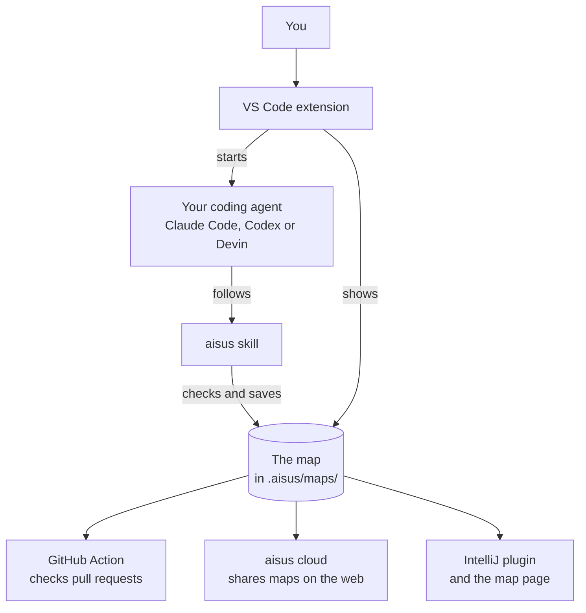
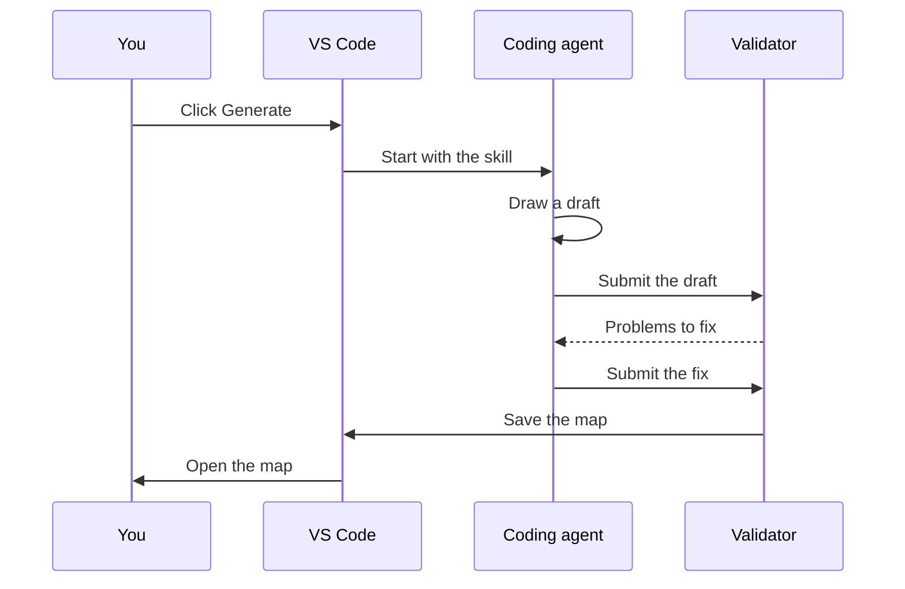

# How aisus works

aisus turns a repository into a map: a diagram of boxes and arrows in which every box cites the lines of code it describes. This page explains how the pieces fit together. The full reference for each module, written for coding agents and contributors who change the code, is `docs/architecture.md` in the repository.

## The big picture

aisus never calls an AI model itself. A coding agent you already use, such as Claude Code, Codex or Devin, reads your code and draws the map by following an aisus skill. aisus checks the result, shows it, and tells you when the code has moved on.

## How a map is made

1. You click **Generate** in the aisus sidebar, with an optional focus such as "payment flow".
2. aisus starts your coding agent with the aisus skill, and the sidebar shows the agent's progress.
3. The skill's first script collects facts about the repository, such as its files, languages and git state.
4. The agent reads the code and writes a draft map. Each box names the files and lines it describes.
5. The skill's second script, the validator, checks the draft. It refuses a box that cites a file outside the repository, a line that does not exist or a secret such as a `.env` file, and it tells the agent what to fix.
6. When the draft passes, the validator saves the map with a fingerprint of every cited line, and the map opens.

## Opening the code behind a box

Click a box, and aisus opens the lines it cites beside the map. Before it opens them, aisus checks again that the file is inside the repository and still has those lines. When the code has moved, aisus says so and offers to refresh the map.

## Staying up to date

A map records a fingerprint of every line it cites. Whenever a cited file changes, aisus compares the code with those fingerprints.

- A box whose code changed is marked **changed**.
- A box whose file is gone is marked **missing**.
- A renamed file is followed to its new name.

This check runs no agent and spends no tokens. **Refresh** then asks the agent to redraw only the boxes that changed.

## Checking pull requests

The same check runs in three places: the `aisus.mjs` command line, the GitHub Action, and **Review changes** in the sidebar. It compares a branch with the map, and reports the boxes the branch touches, the boxes it leaves out of date, and the changed files that no box covers. The Action posts this report as a comment on the pull request. [The GitHub Action guide](github-action.md) shows how to set it up.

## Sharing maps

- **In the repository.** Maps are plain JSON files in `.aisus/maps/`, so you commit them with your code and your team gets them with the next pull.
- **As a page.** Each map also comes as one HTML file that opens in any browser.
- **On the web.** aisus cloud keeps uploaded maps so a team can open them at aisus.dev. Only the map and check results are sent, never your code. [The aisus cloud guide](cloud.md) shows how.
- **In IntelliJ IDEA.** The IntelliJ plugin shows the same map with the same viewer.

## Where the code lives

| Folder | What it holds |
|---|---|
| `apps/vscode/` | The VS Code extension: the sidebar, the map panel and the agent launcher |
| `packages/viewer/` | The map viewer, shared by VS Code, aisus cloud and the IntelliJ plugin |
| `packages/core/` | The map format, the validator, the layout, git facts and the change check |
| `skills/` | The agent skills and their scripts |
| `packages/cli/` | The `aisus.mjs` command line |
| `apps/action/` | The GitHub Action |
| `apps/cloud/` | aisus cloud, the site at aisus.dev |
| `apps/intellij/` | The IntelliJ plugin |

## What aisus is careful about

- **Your code stays with you.** The extension sends nothing over the network. Sharing to aisus cloud is the one exception, and it happens only when you ask and sends only the map.
- **Boxes cite only safe files.** A box can cite only files inside the repository, and never secrets such as `.env` files, keys or the `.git` folder.
- **Agents start with limits.** aisus starts an agent directly, without a shell, with a fixed list of tools, and never with a flag that skips its permission prompts.
- **The map panel is locked down.** It runs under a strict content security policy and only ever receives the map's data.

## Learn more

- Each decision behind this design is recorded in `docs/adr/` in the repository.
- `docs/architecture.md` describes every module, message and file format in detail.
- [Contributing](../CONTRIBUTING.md) explains how to set up the repository and send a change.
